# ToDo List

Aplicación móvil de lista de tareas construida con **Ionic Framework + React + TypeScript** y
empaquetada con **Capacitor**. Este repositorio reúne las dos entregas del proyecto: la aplicación
base de la **EVA1** y la ampliación de la **EVA2** con almacenamiento local, usuarios, cámara, GPS e
integración con una API externa.

La interfaz mantiene el estilo **Aurora UI**: degradados suaves, superficies de vidrio esmerilado y
acentos violeta/cian.

# EVA2: usuarios, periféricos y API

La segunda entrega amplía la aplicación con las funcionalidades avanzadas pedidas en la evaluación.

## Funcionalidades agregadas

- **Autenticación local multiusuario:** registro e inicio de sesión con usuario y contraseña. La
  contraseña nunca se guarda en texto plano: se almacena un hash SHA-256 con sal única por usuario.
- **Sesión persistente:** al recargar la aplicación se mantiene el usuario activo hasta cerrar
  sesión desde el menú lateral.
- **Tareas por usuario:** cada cuenta tiene su propia lista, guardada en el dispositivo con
  `@capacitor/preferences` (en web usa `localStorage`). Las tareas sobreviven a la recarga, cierre de
  la aplicación o reinicio del navegador.
- **Cámara:** el botón **Adjuntar foto** captura o elige una imagen con `@capacitor/camera` y la
  guarda junto a la tarea. La foto se muestra en la vista previa y en la lista.
- **GPS:** al crear una tarea se registra la ubicación actual con `@capacitor/geolocation`. Las
  coordenadas se muestran en la tarea y enlazan a Google Maps.
- **Importación desde API:** descarga tareas desde una API pública y las agrega a la lista sin
  duplicar las que ya existen.
- **Sincronización con API:** envía las tareas locales a la API mediante `POST` e informa cuántas se
  sincronizaron.
- **Plataforma Android:** proyecto nativo generado con `@capacitor/android`, con los permisos de
  cámara y ubicación declarados en el manifiesto.

## Permisos del dispositivo

| Permiso | Plugin / plataforma | Uso |
| --- | --- | --- |
| `CAMERA` | `@capacitor/camera` | Capturar o adjuntar una foto a la tarea |
| `READ_MEDIA_IMAGES` / `READ_EXTERNAL_STORAGE` | `@capacitor/camera` | Elegir una imagen de la galería en Android |
| `ACCESS_FINE_LOCATION` / `ACCESS_COARSE_LOCATION` | `@capacitor/geolocation` | Registrar latitud y longitud de la tarea |
| `INTERNET` | API externa | Importar y sincronizar tareas |

Antes de usar cada periférico se consulta el estado del permiso con `checkPermissions()` y, si es
necesario, se solicita con `requestPermissions()`. Si el usuario lo deniega, la aplicación muestra un
mensaje claro: la tarea se guarda sin ubicación y la foto no se adjunta, sin bloquear el resto del
flujo. En Android los permisos están declarados en `android/app/src/main/AndroidManifest.xml` y las
funciones de cámara y GPS se marcan como opcionales (`uses-feature required="false"`).

## Integración con la API

Se usa [JSONPlaceholder](https://jsonplaceholder.typicode.com), una API pública de demostración que
no requiere clave:

- **Importar:** `GET /todos?_limit=5`. Las tareas recibidas se normalizan y se agregan solo si su
  identificador no estaba en la lista.
- **Sincronizar:** `POST /todos` por cada tarea local, enviando título y descripción.

Al ser una API de demostración, el servicio responde con éxito pero no conserva los datos enviados.
La lógica está aislada en `src/lib/api.ts` para poder cambiar la URL por la de un backend real sin
tocar la interfaz.

## Requisitos y ejecución

- Node.js 20 o superior (probado con Node 24) y npm
- Navegador moderno para la versión web
- Android Studio con Android SDK para compilar la aplicación nativa

```bash
# 1. Instalar dependencias
npm install

# 2. Ejecutar en el navegador (http://localhost:8100)
npx --yes @ionic/cli serve

# Alternativa con Vite directamente (http://localhost:5173)
npm run dev

# 3. Compilar la versión web y sincronizarla con Android
npm run build
npx cap sync android

# 4. Abrir el proyecto nativo en Android Studio
npx cap open android
```

Desde Android Studio se ejecuta la app en un emulador o dispositivo con los permisos de cámara y
ubicación habilitados. En la versión web, la cámara abre el selector de archivos y el GPS usa la
geolocalización del navegador, por lo que conviene probar los periféricos en un dispositivo real.

## Pruebas

```bash
npm run test:unit    # Vitest: 24 pruebas en 6 archivos
npm run test:e2e     # Playwright: 3 pruebas end-to-end
npm run lint         # ESLint + TypeScript + Prettier
```

Las pruebas unitarias cubren las operaciones de tareas, el almacenamiento por usuario, la creación y
verificación de credenciales, los permisos de cámara y GPS (incluidos los casos denegados) y la
importación/sincronización con la API. Las pruebas end-to-end recorren el registro, la creación de
una tarea con foto y coordenadas, la persistencia tras recargar, la edición/eliminación y el flujo de
importación y sincronización con la API (con respuestas simuladas).

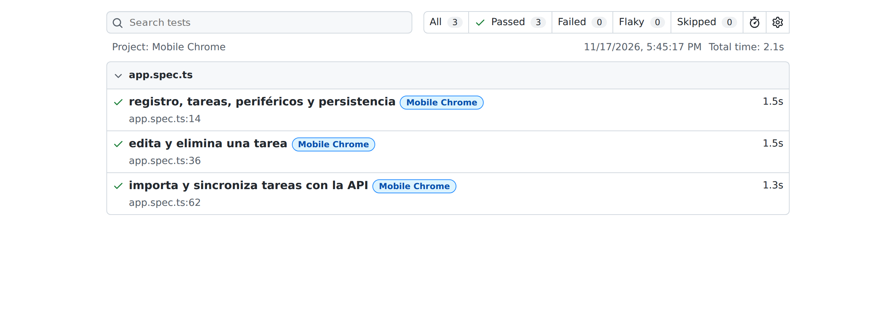

La evidencia se capturó con Chromium en modo móvil; la versión nativa se ejecuta desde Android Studio
abriendo el proyecto `android/`, donde se pueden validar la cámara y el GPS en un emulador o
dispositivo.

## Capturas de pantalla

| Inicio de sesión | Registro de usuario |
| --- | --- |
| 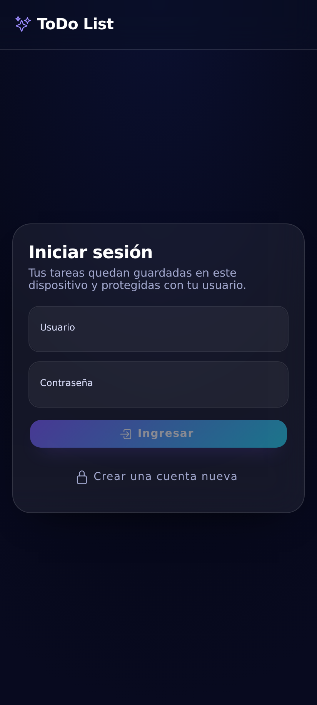 | 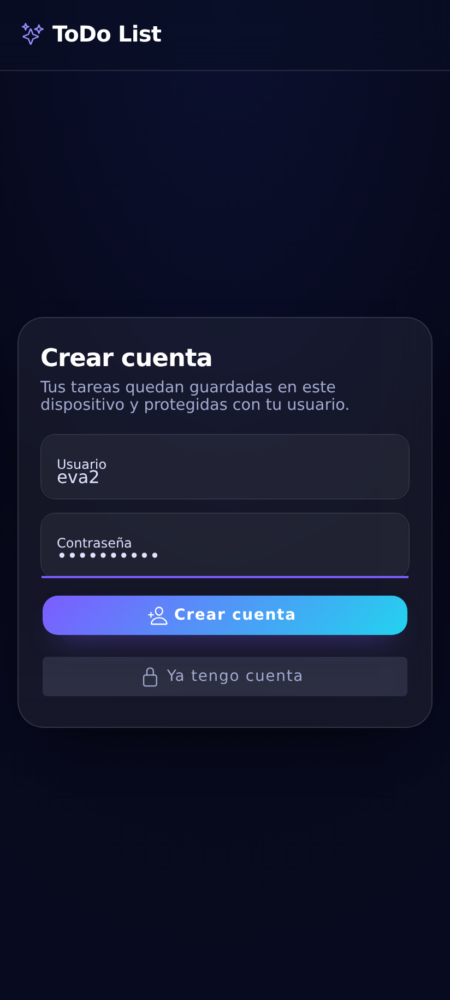 |

| Tarea con foto adjunta | Tarea guardada con GPS |
| --- | --- |
| 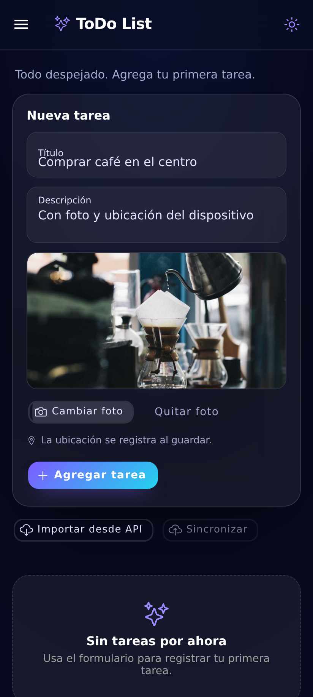 | 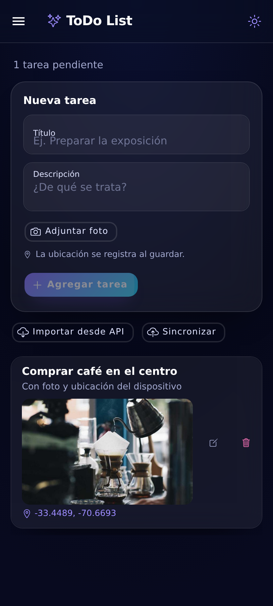 |

| Menú con sesión activa | Importación desde la API |
| --- | --- |
| 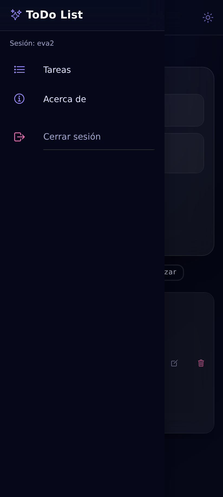 | 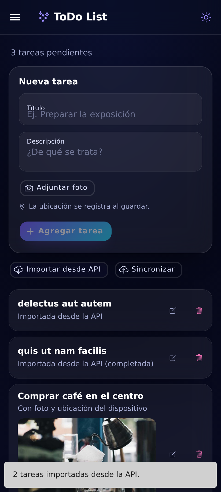 |

## Estructura del proyecto

```text
todolist_app/
├── android/                     # Proyecto Android generado por Capacitor
├── docs/screenshots/            # Capturas de la EVA1
├── docs/screenshots/eva2/       # Capturas y evidencia de la EVA2
├── e2e/app.spec.ts              # Pruebas end-to-end (Playwright)
├── public/                      # favicon y manifest
├── src/
│   ├── components/
│   │   ├── AuthProvider.tsx     # Estado de sesión y acciones de autenticación
│   │   ├── Menu.tsx             # Menú lateral con usuario y cierre de sesión
│   │   └── Menu.css
│   ├── lib/
│   │   ├── api.ts               # Importación y sincronización con la API
│   │   ├── auth.ts              # Hash con sal y validación de credenciales
│   │   ├── auth-context.ts      # Contexto de autenticación
│   │   ├── device.ts            # Cámara y GPS con manejo de permisos
│   │   ├── storage.ts           # Persistencia con @capacitor/preferences
│   │   ├── tasks.ts             # Tipo Task y operaciones puras
│   │   └── *.test.ts            # Pruebas unitarias
│   ├── pages/
│   │   ├── Login.tsx            # Registro e inicio de sesión
│   │   ├── Login.css
│   │   ├── Home.tsx             # Lista, formulario, periféricos y API
│   │   ├── Home.css
│   │   ├── About.tsx            # Página informativa breve
│   │   └── About.css
│   ├── theme/variables.css      # Tokens de color para modo claro y oscuro
│   ├── App.tsx                  # Root: autenticación, router y menú
│   └── main.tsx                 # Punto de entrada de React
├── capacitor.config.ts
├── ionic.config.json
├── playwright.config.ts
├── vite.config.ts
└── package.json
```

# EVA1: aplicación base de tareas

Primera entrega del proyecto: una aplicación móvil con Ionic que permite crear, editar y eliminar
tareas (título y descripción), navegar entre la lista y una sección informativa, y alternar entre
modo claro y oscuro. Los pasos de instalación y ejecución son los mismos de la sección anterior.

## Stack técnico

| Capa | Tecnología |
| --- | --- |
| Framework UI | Ionic 9 (`@ionic/react`) |
| Frontend | React 19 + TypeScript |
| Build / dev server | Vite 8 + Ionic CLI 7 |
| Estilos | CSS con variables de Ionic (`theme/variables.css`) |
| Pruebas | Vitest + Testing Library (unitarias) y Playwright (e2e) |
| Empaquetado móvil | Capacitor |

## Conceptos de Ionic

- **Componentes reutilizables:** Ionic ofrece piezas ya hechas (`ion-button`, `ion-list`,
  `ion-input`) que funcionan en cualquier navegador y se combinan como bloques.
- **Estilos propios:** cada pieza protege su apariencia interna; se personaliza con variables de
  color y borde (`--background`, `--color`) en lugar de reescribir su HTML.
- **React como base:** cada pieza se usa como un componente de React; lo que se ve en pantalla
  sale del estado y los cambios se avisan con eventos (`value` + `onIonInput`).
- **Navegación:** las páginas Tareas y Acerca de se declaran como rutas y se muestran con
  animación; el menú se adapta a móvil (`IonMenu`) y a escritorio (`IonSplitPane`).
- **Temas:** los colores se definen una vez en `theme/variables.css`; el modo oscuro solo agrega
  una clase al documento.

## Patrones de diseño usados

- **Contenedor con estado central:** `Home` guarda la lista, el formulario y el tema.
  *Por qué:* hay una sola fuente de verdad y el flujo de datos es fácil de seguir.
- **Campos controlados:** el valor de cada campo vive en React, no en el HTML.
  *Por qué:* lo que se ve y lo que se guarda nunca se desincroniza.
- **Lógica pura e inmutable:** `addTask`, `updateTask` y `removeTask` siempre devuelven una lista
  nueva. *Por qué:* el resultado es predecible y se prueba sin tocar la interfaz.
- **Composición por espacios (slots):** el contenido se ubica en lugares definidos
  (`slot="start"`, `slot="end"`). *Por qué:* se reutilizan las piezas sin duplicarlas.
- **Navegación declarativa:** las rutas se escriben una sola vez y sirven para móvil y escritorio.
  *Por qué:* menos código repetido y el menú siempre coincide con la página visible.

## Componentes de Ionic utilizados

`IonApp`, `IonReactRouter`, `IonRouterOutlet`, `IonSplitPane`, `IonMenu`, `IonMenuButton`,
`IonMenuToggle`, `IonPage`, `IonHeader`, `IonToolbar`, `IonTitle`, `IonButtons`, `IonContent`,
`IonList`, `IonItem`, `IonLabel`, `IonInput`, `IonTextarea`, `IonButton`, `IonIcon`, `IonNote` e
`IonToast`.

## Capturas de pantalla

| Estado vacío | Lista en modo claro |
| --- | --- |
| 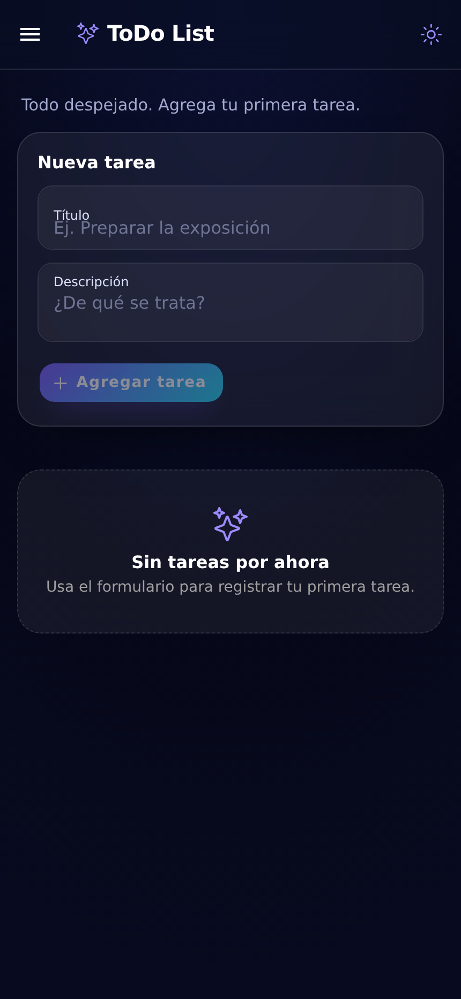 | 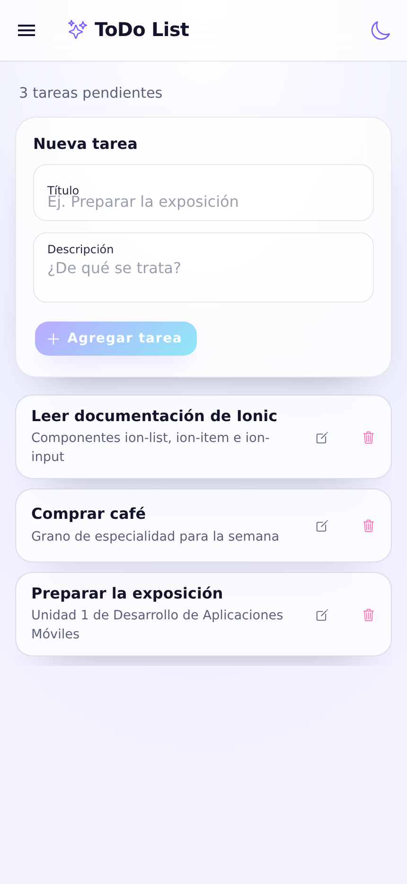 |

| Modo oscuro | Edición de una tarea |
| --- | --- |
| 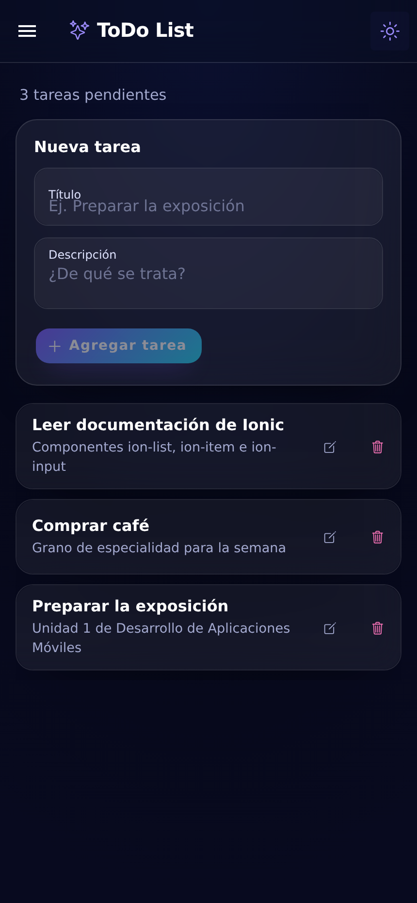 | 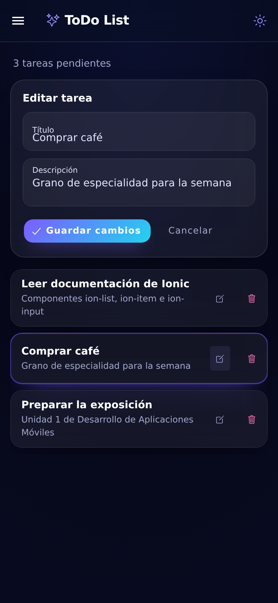 |

| Menú de navegación | Acerca de |
| --- | --- |
| 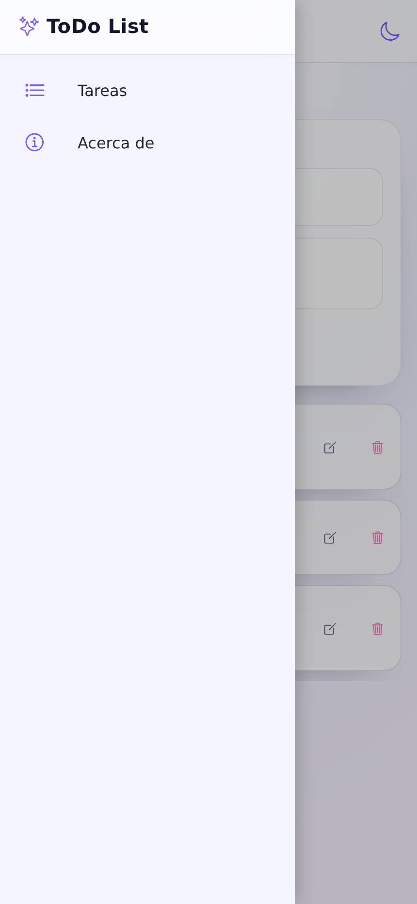 | 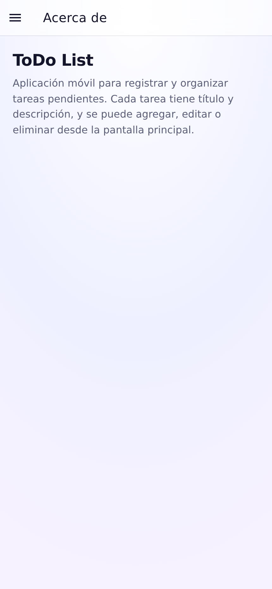 |

Vista de escritorio (menú fijo con `IonSplitPane`):

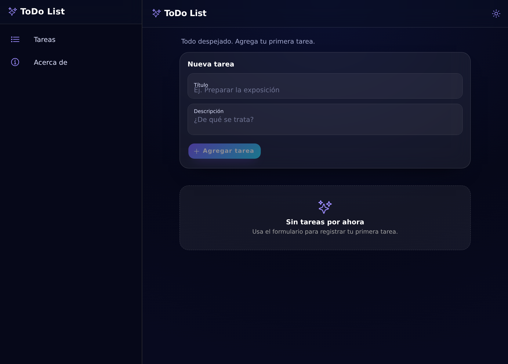
