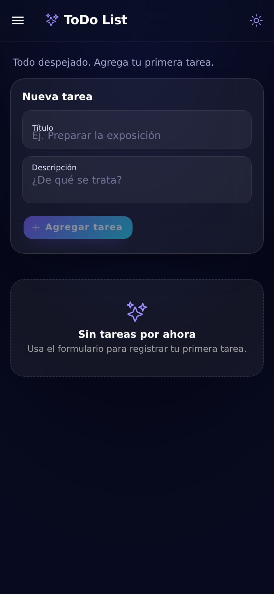
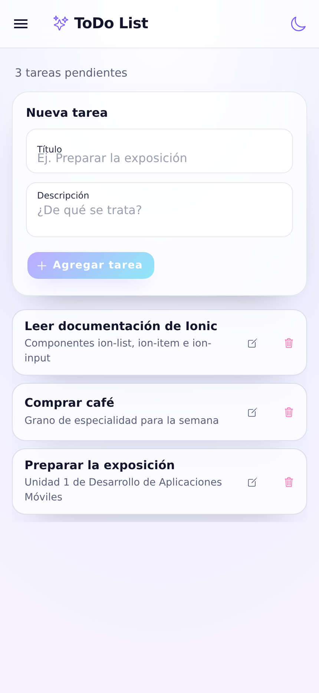
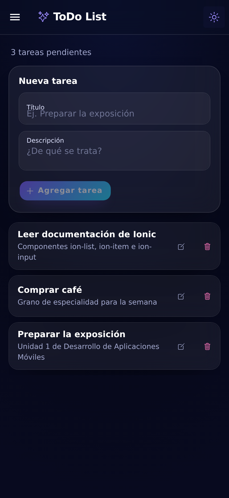
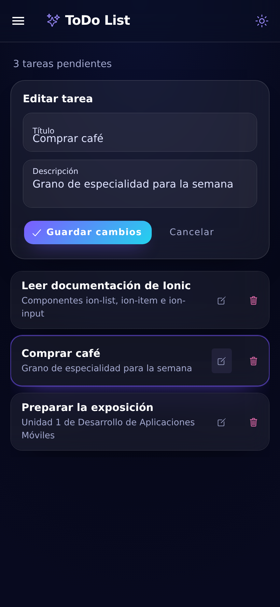
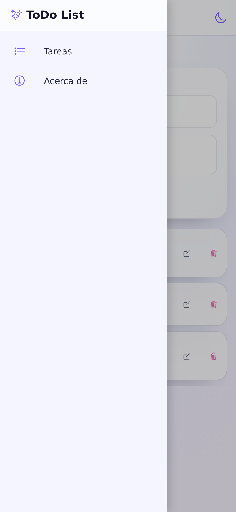
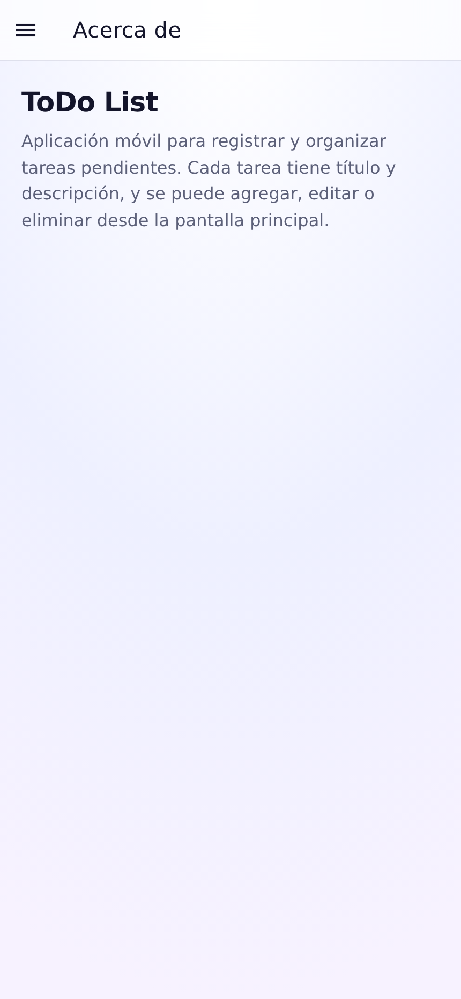
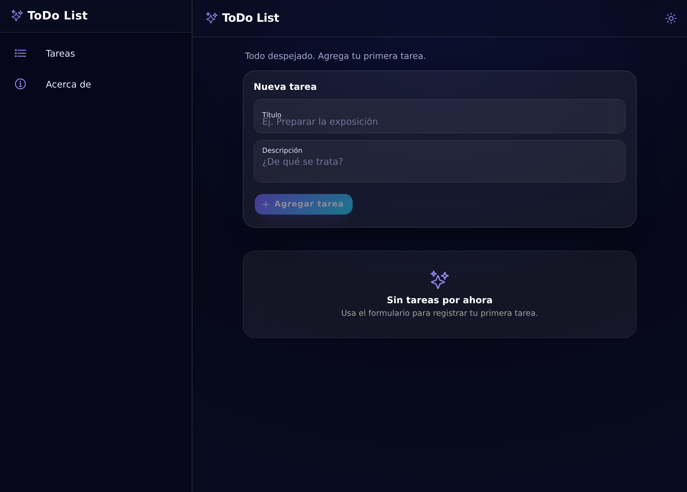

# ToDo List

Aplicación móvil de lista de tareas construida con **Ionic Framework + React**. Permite crear,
editar y eliminar tareas (título y descripción), navegar entre la lista y una sección informativa,
y alternar entre modo claro y oscuro. La interfaz sigue el estilo **Aurora UI**: degradados suaves,
superficies de vidrio esmerilado y acentos violeta/cian.

## Stack técnico

| Capa | Tecnología |
| --- | --- |
| Framework UI | Ionic 9 (`@ionic/react`) |
| Frontend | React 19 + TypeScript |
| Build / dev server | Vite 8 + Ionic CLI 7 |
| Estilos | CSS con variables de Ionic (`theme/variables.css`) |
| Pruebas | Vitest + Testing Library (unitarias) y Playwright (e2e) |
| Empaquetado móvil | Capacitor |

## Conceptos de Ionic

- **Componentes reutilizables:** Ionic ofrece piezas ya hechas (`ion-button`, `ion-list`,
  `ion-input`) que funcionan en cualquier navegador y se combinan como bloques.
- **Estilos propios:** cada pieza protege su apariencia interna; se personaliza con variables de
  color y borde (`--background`, `--color`) en lugar de reescribir su HTML.
- **React como base:** cada pieza se usa como un componente de React; lo que se ve en pantalla
  sale del estado y los cambios se avisan con eventos (`value` + `onIonInput`).
- **Navegación:** las páginas Tareas y Acerca de se declaran como rutas y se muestran con
  animación; el menú se adapta a móvil (`IonMenu`) y a escritorio (`IonSplitPane`).
- **Temas:** los colores se definen una vez en `theme/variables.css`; el modo oscuro solo agrega
  una clase al documento.

## Patrones de diseño usados

- **Contenedor con estado central:** `Home` guarda la lista, el formulario y el tema.
  *Por qué:* hay una sola fuente de verdad y el flujo de datos es fácil de seguir.
- **Campos controlados:** el valor de cada campo vive en React, no en el HTML.
  *Por qué:* lo que se ve y lo que se guarda nunca se desincroniza.
- **Lógica pura e inmutable:** `addTask`, `updateTask` y `removeTask` siempre devuelven una lista
  nueva. *Por qué:* el resultado es predecible y se prueba sin tocar la interfaz.
- **Composición por espacios (slots):** el contenido se ubica en lugares definidos
  (`slot="start"`, `slot="end"`). *Por qué:* se reutilizan las piezas sin duplicarlas.
- **Navegación declarativa:** las rutas se escriben una sola vez y sirven para móvil y escritorio.
  *Por qué:* menos código repetido y el menú siempre coincide con la página visible.

## Componentes de Ionic utilizados

`IonApp`, `IonReactRouter`, `IonRouterOutlet`, `IonSplitPane`, `IonMenu`, `IonMenuButton`,
`IonMenuToggle`, `IonPage`, `IonHeader`, `IonToolbar`, `IonTitle`, `IonButtons`, `IonContent`,
`IonList`, `IonItem`, `IonLabel`, `IonInput`, `IonTextarea`, `IonButton`, `IonIcon` e `IonNote`.

## Requisitos para ejecución

- Node.js 20 o superior (probado con Node 24) y npm
- Navegador moderno
- No hace falta instalar Ionic CLI globalmente: se ejecuta con `npx`, que lo descarga
  automáticamente la primera vez.

## Pasos de ejecución

```bash
# 1. Instalar dependencias
npm install

# 2. Levantar la aplicación (disponible en http://localhost:8100)
npx --yes @ionic/cli serve

# Alternativa con Vite directamente (http://localhost:5173)
npm run dev
```

Si ya tenés Ionic CLI instalado globalmente, `ionic serve` también funciona.

Otros comandos:

```bash
npm run build        # compila TypeScript y genera dist/
npm run test:unit    # pruebas unitarias de las operaciones de tareas
npm run test:e2e     # e2e: agregar, editar y eliminar (Playwright)
npm run lint         # ESLint + Prettier
```

## Estructura del proyecto

```text
todolist_app/
├── docs/screenshots/          # Capturas de la aplicación
├── e2e/app.spec.ts            # Prueba end-to-end del flujo de tareas
├── public/                    # favicon y manifest
├── src/
│   ├── components/
│   │   ├── Menu.tsx           # Menú lateral de navegación
│   │   └── Menu.css
│   ├── lib/
│   │   ├── tasks.ts           # Tipo Task y operaciones puras
│   │   └── tasks.test.ts      # Pruebas unitarias
│   ├── pages/
│   │   ├── Home.tsx           # Lista, formulario y toggle de tema
│   │   ├── Home.css
│   │   ├── About.tsx          # Página informativa breve
│   │   └── About.css
│   ├── theme/variables.css    # Tokens de color para modo claro y oscuro
│   ├── App.tsx                # Root: router, menú y CSS base
│   └── main.tsx               # Punto de entrada de React
├── AGENTS.md                  # Contexto para agentes de código
├── capacitor.config.ts
├── ionic.config.json
├── playwright.config.ts
├── vite.config.ts
└── package.json
```

## Capturas de pantalla

| Estado vacío | Lista en modo claro |
| --- | --- |
|  |  |

| Modo oscuro | Edición de una tarea |
| --- | --- |
|  |  |

| Menú de navegación | Acerca de |
| --- | --- |
|  |  |

Vista de escritorio (menú fijo con `IonSplitPane`):


